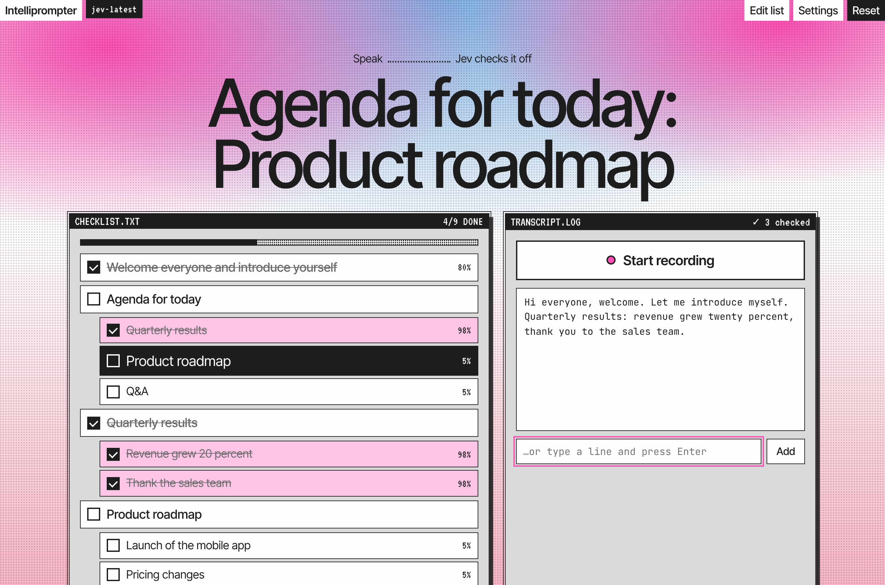

# Intelliprompter

Talk through your checklist; items tick themselves off as you say them.



Your browser transcribes the microphone live. The transcript goes to
[Jev](https://typesafe.ai), TypeSafe AI's decision model, which answers one
yes/no question per open item: *"has the speaker covered this?"*. Items Jev is
confident about get checked. The next open item is shown big at the top, like a prompter.

## Setup (1 minute)

Needs Node.js 22+ and a TypeSafe API key (from the TypeSafe API console). No `npm install` needed: there are no dependencies.

```bash
git clone https://github.com/thesnarkitecht/intelliprompter && cd intelliprompter
```

```bash
npm start
```

Open http://localhost:3000, click **Settings**, and paste your API key.

To keep the key on the server instead, copy `.env.example` to `.env` and set
`TYPESAFE_API_KEY`. That key then takes precedence over one pasted in the browser.

## Using it

- **Edit list**: one item per line; indent a line (space or tab) to make it a sub-item.
  A parent is checked automatically when all its sub-items are.
- **Start recording**: speak. Use Chrome, Edge or Safari (Firefox has no built-in speech recognition).
  You can also type lines into the box under the transcript.
- Click any item to check or uncheck it yourself. Clicking a parent toggles all its sub-items.
- **Settings**: confidence threshold (default 70%) and speech language.
- **Reset**: unchecks everything and clears the transcript.

The list, checks and transcript are saved in your browser.

## Config (env vars)

| Variable | Default |
|---|---|
| `TYPESAFE_API_KEY` | none (use the Settings key) |
| `JEV_MODEL` | `jev-latest` |
| `PORT` | `3000` |
| `TYPESAFE_API_URL` | `https://api.typesafe.ai/v1/systemone` |

## Develop

`npm test` checks the outline parser, the Jev request and response handling, and the server proxy against a fake Jev.

Files: `server.js` (static files + `/api/check` proxy), `public/core.js` (pure logic),
`public/app.js` (UI + speech), `public/style.css`.

## Privacy notes

- In Chrome and Edge, the browser's speech recognition sends audio to the browser vendor's servers.
- Text transcripts go to TypeSafe through your local server.
- A key pasted in Settings is stored in this browser's localStorage.
